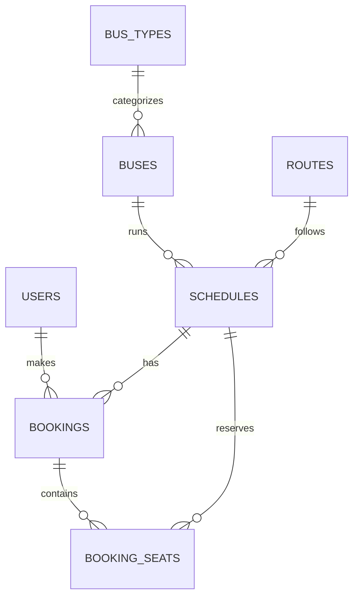

# TicketTrail – Bus Ticket Booking System


A full-stack bus ticket booking web app built with PHP and MySQL.
Passengers can search trips, choose seats on an interactive seat map, book and cancel tickets.
Admins manage bus types, buses, routes and trip schedules from a dashboard.

---
## Project Structure

```
Ticket_trail/
├── admin/index.php        # Admin dashboard
├── assets/css/style.css   # Styles
├── config/db.php          # Database connection and settings
├── database/schema.sql    # Tables and demo data
├── includes/              # Shared helpers, header and footer
├── tests/run_tests.php    # Automated test suite
├── index.php              # Search page
├── book.php               # Seat selection and booking
├── my_bookings.php        # Booking history and cancellation
├── login.php / register.php / logout.php
└── setup.php              # One-time admin creation


##  Features

### For passengers
- Sign up and log in securely
- Search trips by source, destination and date
- Interactive seat map showing available, selected and booked seats
- Live fare total while choosing seats (up to 6 seats per booking)
- Booking history with payment reference and status
- Cancel upcoming bookings, which instantly releases the seats

### For admins
- Dashboard with customers, upcoming trips, active bookings and revenue
- Add bus types, buses and routes
- Schedule trips with automatic fare calculation (route base fare + bus type surcharge)
- Delete trips that have no bookings
- View recent bookings

### Security and data integrity
- Passwords hashed with bcrypt (`password_hash`)
- All queries use PDO prepared statements (SQL injection protection)
- CSRF tokens on every form
- All output escaped (XSS protection)
- Double booking is impossible: the database rejects a second booking of the same seat
- Bookings and cancellations run inside transactions

---

## 🗄️ Database Design



| Table | Purpose |
|---|---|
| `users` | Passengers and admins (separated by a `role` column) |
| `bus_types` | Bus categories such as AC Sleeper, with a fare surcharge |
| `buses` | Registration number, name, type and seat count |
| `routes` | Source, destination, distance and base fare |
| `schedules` | A bus on a route at a departure time, with its fare |
| `bookings` | One record per checkout, with payment reference and status |
| `booking_seats` | Seats in each booking. The primary key `(schedule_id, seat_no)` prevents double booking |

---

## 🧪 Testing

The test suite checks the database schema, helper functions, and the full booking flow:
registration, duplicate email rejection, fare calculation, seat booking, double-booking
prevention, cancellation, and database constraints. All test data is rolled back,
so the database is never modified.

```bash
php tests/run_tests.php
```


